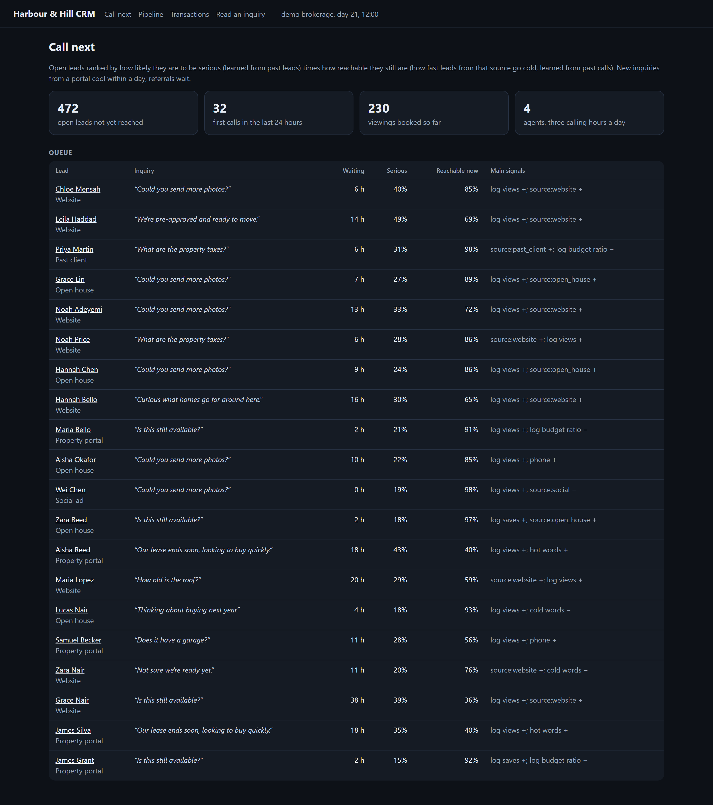
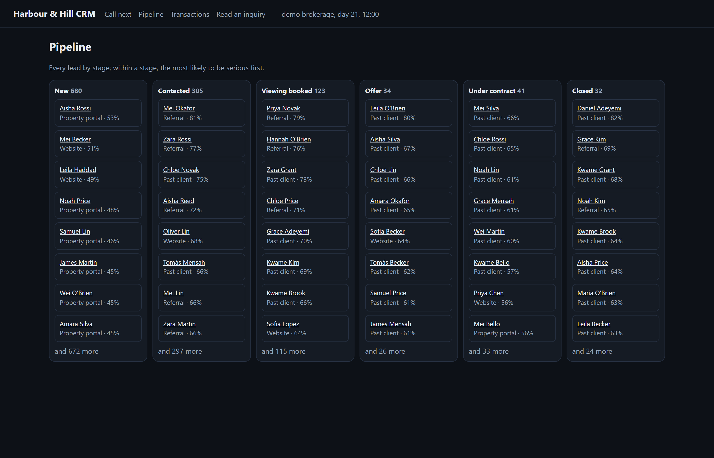
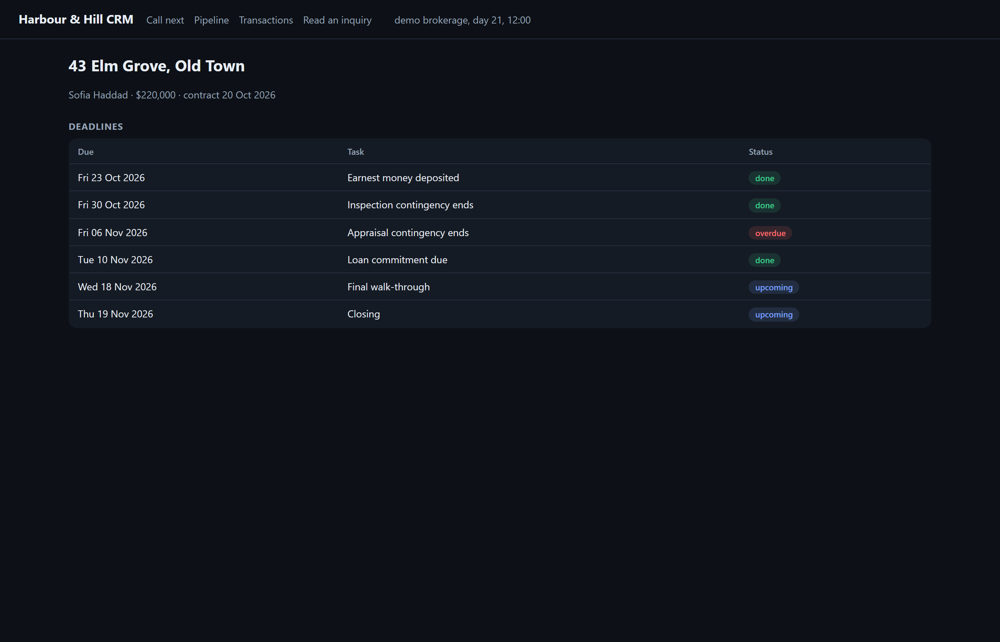

# Real Estate CRM and Transaction Management

[](https://github.com/codeROCK-IZZY/real-estate-crm/actions/workflows/ci.yml)


A CRM for estate agents covering the two places deals are usually lost:

- **Leads that go cold before anyone calls.** A portal inquiry has usually gone to several agents and cools within a
  day. A brokerage gets more inquiries than its agents have calling time. This CRM ranks the call queue by how likely
  each lead is to be serious (learned from the brokerage's past leads) times how reachable they still are (learned
  from past calls).
- **Contract deadlines that slip.** Earnest money, inspection, appraisal, loan commitment, walk-through and closing
  dates are worked out from the contract's terms, counting business days around weekends and US federal holidays,
  and each one is tracked as a task.

It also has a pipeline board and reads new inquiries into structured fields (goal, budget, bedrooms, areas,
timeline, pre-approval) with Claude, keeping only what the message actually says.



## Results

`recrm evaluate --gate` simulates brokerages over two months. Inquiries arrive through the day from six sources;
agents have three calling hours a day, so there are more leads than calls. Each lead has a hidden seriousness, and
reachability that fades at a rate set by its source. The model and the cooling speeds were trained on 6 tuning
brokerages. These are **15 held-out brokerages** (72 agents, 60,170 leads):

| Who is called first | Deals | Viewings | Serious leads never called | Median wait for a serious lead |
|---|---:|---:|---:|---:|
| Oldest first (inbox order) | 370 | 741 | 7,966 of 11,236 | 334.5 h |
| Newest first (speed to lead) | 4,056 | 9,354 | 4,985 of 11,236 | 1.6 h |
| Referrals, then urgent words, then newest | 4,537 | 10,375 | 3,164 of 11,236 | 2.5 h |
| **Seriousness × reachability (this CRM)** | **5,200** | **11,790** | **1,330 of 11,236** | 3.1 h |

On 8 brokerages held back from a **shifted market** (portal leads better and referrals worse than in training,
message words weaker and browsing stronger), the CRM still beat newest first by 17% (3,239 deals against 2,772),
and by 18% (3,274) once retrained on each brokerage's own earlier two months.

What the numbers show:

- **Inbox order is the worst habit.** When there are more leads than calls, working the oldest first means calling
  people who went cold days ago. That gives a tenth of the deals of any other method.
- **Speed alone isn't enough.** Calling the newest lead first reaches people fast, but spends scarce calls on leads
  that were never serious. Ranking by seriousness × reachability closed **28% more deals** than newest first and 15%
  more than simple rules. Serious leads never called fell **from 4,985 to 1,330**.
- **It waits a little longer on purpose.** The median serious lead is called after 3.1 hours instead of 1.6, because
  a referral can wait and a serious portal lead cannot.
- **The model must follow the market.** The gain held in the shifted market, and retraining on local history added
  a little more. The CRM retrains on each brokerage's own leads.
- **A bug the console caught.** The first trained model scored urgent words *down*. It had learned from a history
  worked oldest-first, which almost never reaches a lead within two days, so it saw only a few hundred examples. It
  now learns from a history worked newest-first (16,064 examples). All banks were run again; the first run's
  numbers are in [ADR 1](docs/adr/0001-seriousness-times-reachability.md).

Read these as a test of the method, not a forecast. In the simulation, seriousness depends on the same kinds of
signals the model reads (see [known limitations](docs/known-limitations.md)).



## How it works

```
past leads (worked newest first) ─► logistic regression: seriousness from source, words, budget, views, saves, phone
past calls ─► per source, how fast leads stop answering (maximum likelihood on answered / unanswered by lead age)
now ─► priority = P(serious) × e^(−age / cooling time of its source) ─► call queue, with the signals behind each score
contract + terms ─► deadlines (business or calendar days, weekends and holidays rolled forward) ─► tasks and alerts
inquiry ─► Claude (strict tool, quotes required) ─► checked against the message and the areas we cover ─► fields
```

- **Model** (`model.py`). Plain numpy logistic regression with L2, trained only on leads reached within two days,
  so it learns what serious leads look like rather than who happened to answer late. See
  [ADR 1](docs/adr/0001-seriousness-times-reachability.md).
- **Cooling** (`queue.py`). Learned from the brokerage's own call history, never from the simulator's settings. The
  learned values (portal 20 h, social 16 h, referral 204 h) are close to the truth, which shows that's possible.
- **Deadlines** (`deadlines.py`). US federal holidays with observed dates. Calendar-day deadlines roll forward off
  weekends and holidays, the walk-through is the business day before closing, and a deadline after closing is
  refused. See [ADR 2](docs/adr/0002-deadlines-in-business-days.md).
- **Inquiries** (`intake.py`). Claude (`claude-opus-5-5`, low effort, refusal fallbacks) fills a strict tool. Each
  field must quote the message, areas must be ones the brokerage covers, and numbers must be in range. Without a key,
  or on a refusal, rules fill what they can. See [ADR 3](docs/adr/0003-inquiries-with-quotes.md).



Decisions: [docs/adr](docs/adr). Gaps: [docs/known-limitations.md](docs/known-limitations.md).

## Run it

```bash
python -m venv .venv && . .venv/bin/activate
pip install -e ".[dev]"

recrm queue                                    # who to call next in the demo brokerage
recrm read "Pre-approved up to \$450k, 3 beds in Riverside within 6 weeks"
recrm deadlines 2026-11-20 2026-12-28          # every deadline for a contract
recrm serve                                    # the console on http://127.0.0.1:8000
recrm evaluate --gate                          # eval/reports/report.{md,json,html}
pytest
```

API: `GET /api/queue`, `POST /api/leads {"message", "source", "views", "saves", "phone"}` (read and scored), and
`POST /api/transactions {"contract", "closing"}` (deadlines).

## Tests and CI

- **Core:** a deterministic world; the model recovering a known rule; cooling learned from calls; equal capacity for
  every policy; oldest-first starving new leads; priority favouring serious, still-warm leads; holidays with observed
  dates; business-day deadlines across Thanksgiving, weekend roll-forward and Christmas; deadlines after closing
  refused; task status.
- **Services:** inquiry reading **through the real Anthropic SDK** with canned responses (the request shape, a clean
  read, fields dropped for missing quotes, out-of-range values or unknown areas, a refusal falling back to rules),
  the rules on four kinds of message, the console's pages and API, and the CLI.
- **CI:** ruff, `mypy --strict`, tests on Python 3.12 and 3.13, the evaluation gate, the container serving the
  console, and a gitleaks scan of the full history.

## License

MIT
